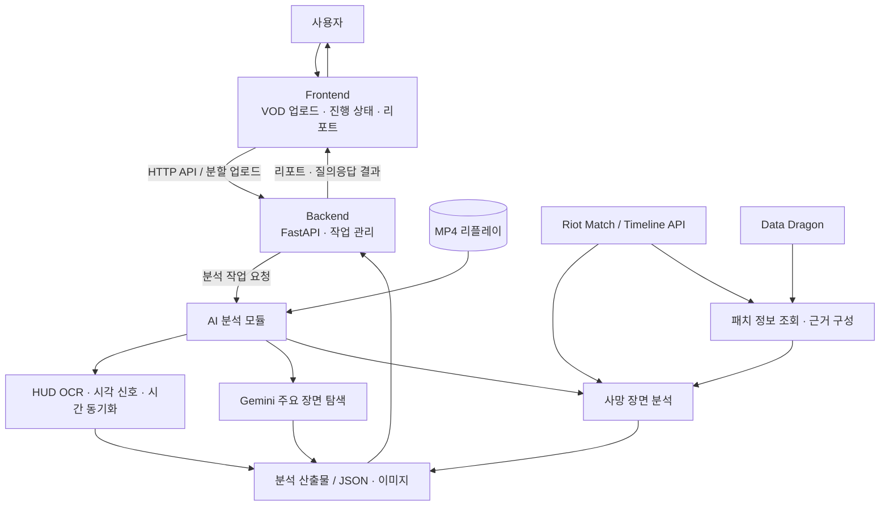

# LOLDOV AI — League of Legends VOD 분석 및 코칭 파이프라인

> **LOLDOV**는 리그 오브 레전드(LoL) 경기 리플레이 영상(VOD)에서 코칭 가치가 있는 장면을 찾고, 영상 분석 결과와 Riot API 경기 기록, 해당 경기 패치의 게임 정보를 결합해 복기·개선 방향을 제시하는 AI 코칭 프로젝트입니다.
>
> 이 저장소는 **AI 분석 파이프라인과 실험 코드**를 담당합니다. 웹 API 서버와 사용자 화면은 각각 별도 저장소에서 관리합니다.

| 구성 요소 | 저장소 | 역할 |
|---|---|---|
| **AI (현재 저장소)** | [LOLDOV/AI](https://github.com/LOLDOV/AI) | VOD 분석, 장면 선정, Riot API·RAG 근거 수집, VLM 코칭 및 검증·평가 |
| **Backend** | [LOLDOV/Backend](https://github.com/LOLDOV/Backend) | FastAPI, 영상 업로드, 분석 작업 관리, 리포트·질의응답 API |
| **Frontend** | [LOLDOV/Frontend](https://github.com/LOLDOV/Frontend) | 업로드·진행 상태·경기 리포트·코치 질의응답 웹 UI |

**주요 기술:** Python 3.12 · OpenCV · RapidOCR · Gemini VLM · Riot Games API · Data Dragon · FastAPI(Backend) · FFmpeg

> **구현 범위 안내:** AI 저장소에는 `main.py` 기반 HUD 분석, `pipeline/` 기반 Gemini v4.0 장면 탐지, `RAG/`의 근거 보강 코칭, `link/`의 사망 장면 코칭 등 **서로 다른 진입점**이 공존합니다. 아래 문서는 하나의 프로그램이 항상 모든 모듈을 순서대로 실행한다고 가정하지 않고, 실제 실행 경로를 구분해 설명합니다.

### 목차

1. [프로젝트 전체 아키텍처 및 데이터 흐름](#1-프로젝트-전체-아키텍처-및-데이터-흐름)
2. [시스템 파이프라인](#2-시스템-파이프라인)
3. [주요 모듈](#3-주요-모듈)
4. [핵심 분석 과정 상세](#4-핵심-분석-과정-상세--riot-api--vod--장면-탐지--vlm--rag--코칭)
5. [3조건 소거 실험](#5-full--no-verify--vlm-only-소거-실험-ablation-study)
6. [실행 환경 및 명령어](#6-실행-환경-의존성-및-실행-명령어)
7. [디렉터리 및 주요 파일](#7-디렉터리별-역할과-주요-파일)
8. [모델 선정 이유 및 개선 방향](#8-모델-선택-이유-기술적-한계-및-향후-개선-방향)

---

## 1. 프로젝트 전체 아키텍처 및 데이터 흐름

LOLDOV는 웹 화면(Frontend), API·작업 관리(Backend), 영상 분석·코칭(AI)을 분리한 구조입니다. Backend·Frontend 저장소의 README를 기준으로 한 서비스 연결 방식은 다음과 같습니다.



### 저장소 배치

세 저장소를 **동일한 상위 디렉터리**에 나란히 배치합니다. 다른 경로를 사용할 경우 Backend에서 `LOLDOV_AI_DIR`, `LOLDOV_FRONTEND_DIR` 환경변수를 지정합니다.

```text
loading/
├── AI/          # 이 저장소: 분석 및 코칭 코드
├── Backend/     # FastAPI 서버
└── Frontend/    # 업로드·리포트 웹 화면과 HTML 템플릿
```

- **Frontend:** `coach/index.html`에서 영상 업로드, 진행 상태, 경기 총평, 장면별 코칭 및 질문 UI를 제공합니다. `report/template.html`은 정적 리포트 템플릿으로 사용됩니다.
- **Backend:** 영상 업로드와 작업 상태를 관리하고 AI 분석 산출물을 리포트·질의응답 API로 제공합니다. 대용량 영상의 분할 업로드는 Backend 쪽에서 처리합니다.
- **AI:** 영상에서 프레임·HUD 신호·후보 장면을 수집하고, 필요한 경우 Riot 경기 기록과 패치 문서를 조회해 Gemini 코칭 결과를 생성합니다.

**서비스 연결에 대한 주의:** 첨부된 Backend README는 AI 저장소의 `main.py` 및 분석 결과를 연동 대상으로 명시합니다. AI 저장소에 추가로 있는 `service/app.py`는 **별도의 로컬 MVP**이며, 배포된 Backend의 `app.server`와 동일한 서버가 아닙니다.

---

## 2. 시스템 파이프라인

프로젝트에는 목적이 다른 세 가지 핵심 실행 흐름이 있습니다.

### A. HUD 기반 VOD 분석 — `main.py` / `vod/`

```text
MP4 입력
  → FFmpeg/ffprobe로 영상 정보 확인
  → 약 1초 간격 프레임 스캔
  → RapidOCR로 HUD 게임 시계·킬 스코어 읽기
  → 화면 움직임·색상 기반 체력바 신호 추출
  → 플레이어 팀 판별 및 게임 시간 ↔ MP4 시간 동기화
  → 킬 변화·Riot Timeline(선택)·시각 신호로 장면 후보 구성
  → 장면별 대표 프레임 추출
  → VLM 분석(선택) 또는 규칙 기반 코칭
  → results/<영상명>/ 저장
```

이 경로는 **HUD·시각 신호 중심의 영상 분석**입니다. `--vlm` 옵션 사용 시 `vlm/scene_analyzer.py`를 통해 OpenAI 호환 API 형식의 시각 모델을 호출합니다.

### B. 전체 VOD Gemini 장면 탐지 — `pipeline/combat_discovery.py`

```text
전체 MP4
  → 24초 단위 구간 분할
  → 약 4초 간격 스토리보드 프레임 샘플링
  → Gemini Scout: 장면 유형·중요도·플레이어 관련성 추정
  → 상위 후보 선별
  → Gemini Dense Verify: 약 2초 간격으로 재검토
  → 영상 전체 후보 재정렬
  → Top-K 장면 선정 (기본 Top-5)
  → results/discovery/<discovery_id>/ 저장
```

여기서 **Dense Verify는 장면 후보를 추가 프레임으로 재검토하는 단계**이며, 뒤에서 설명하는 `link/verify.py`의 **코칭 주장 근거 검증**과는 다른 기능입니다. 선정 장면의 중요도는 **모델 추정치**이며 사람 정답(Ground Truth)이 아닙니다.

### C. Riot·패치 기반 코칭 — `RAG/` / `link/`

```text
선정된 장면 또는 Riot 사망 사건
  → 경기 Match/Timeline 및 분석 대상 플레이어 확인
  → HUD OCR 등으로 MP4 시간과 게임 시간 연결
  → 해당 경기 패치의 Data Dragon 챔피언·아이템 정보 조회
  → 장면 프레임 + Riot 사실 + 패치 문서로 Gemini 코칭 생성
  → 코칭 주장에 프레임(F)·Riot(R)·문서(D) 근거 ID 부여
  → 근거 참조·일부 모순에 대한 규칙 기반 검사
  → 확인 부족 주장 보류, 근거·개선 행동을 결과로 기록
```

`RAG.cli`는 **Gemini Top-K 장면을 보강**하는 경로이고, `link.run`은 **Riot에 기록된 플레이어 사망 사건을 중심으로 별도 코칭**하는 경로입니다. `service/workflow.py`의 로컬 MVP는 B → RAG 코칭 → 사망 장면 코칭 순서로 이 모듈들을 호출합니다.

---

## 3. 주요 모듈

| 모듈 | 핵심 파일 | 담당 기능 |
|---|---|---|
| **영상 분석** | `vod/video.py`, `vod/scan.py`, `vod/hud.py`, `vod/sync.py`, `vod/scenes.py` | 영상 읽기, HUD OCR, 킬·시간·시각 신호, 장면 후보 생성 |
| **VLM 장면 탐지** | `pipeline/combat_discovery.py`, `pipeline/cli.py` | Gemini Scout → Dense Verify → Top-K 탐지 및 결과 캐싱 |
| **Riot API** | `RIOT/client.py`, `RIOT/match_resolver.py`, `RIOT/riot_api.py` | Riot ID/PUUID·Match ID 연계, 경기/타임라인 조회·로컬 캐시 |
| **시간 정렬** | `vod/sync.py`, `RIOT/time_sync.py`, `link/timesync.py` | 영상 시간 ↔ 게임 시간 정렬, 구간별 오프셋 계산 |
| **패치 지식 RAG** | `RAG/cli.py`, `RAG/patch_rag.py`, `link/patch_docs.py` | 경기 버전에 맞는 Data Dragon 자료 수집·검색·근거 구성 |
| **장면 코칭** | `RAG/coaching.py`, `vlm/coach.py`, `vlm/scene_analyzer.py` | 프레임·이벤트·근거를 이용한 VLM 또는 규칙 기반 코칭 |
| **사망 장면 코칭** | `link/riot_facts.py`, `link/coach.py`, `link/run.py` | 플레이어 사망 추출, 16초 구간·8프레임 분석, 코칭 생성 |
| **주장 근거 검증** | `link/verify.py` | F/R/D 참조 유효성·일부 기록 모순·패치 일치 여부 검사 |
| **분석 실험·평가** | `evaluation/`, `pipeline/experiment.py`, `tests/` | 장면·시간 정렬 평가, A/B 실험, 모듈 테스트 |
| **로컬 서비스 MVP** | `service/app.py`, `service/workflow.py`, `service/storage.py` | 자체 로그인, Riot ID 등록, 경기 선택, 분석 작업 실행 |
| **리포트 생성** | `report/build_site.py` | AI 산출물을 Frontend HTML 템플릿과 결합해 정적 리포트 생성 |

> `pipeline/engines/`에는 QWER·CC·소환사 주문 등을 위한 **보조적인 OpenCV 실험 모듈**이 있습니다. 보정된 HUD 프로필이 필요한 기능도 있으므로, 모든 영상을 대상으로 검증된 종단 인식기로 해석하지 않습니다.

---

## 4. 핵심 분석 과정 상세 — Riot API → VOD → 장면 탐지 → VLM → RAG → 코칭

### 4.1 Riot API: 경기·플레이어 식별 및 사건 수집

- Riot ID(`게임이름#태그`)를 PUUID로 조회하고, 해당 계정의 최근 경기 목록 및 Match ID를 가져옵니다.
- Match JSON에서 참가자·챔피언·포지션·승패·경기 버전을 확인합니다.
- Timeline JSON에서 킬·사망·어시스트·오브젝트 등의 사건과 게임 시각을 수집합니다.
- 다운로드한 경기 데이터는 `data/riot/matches/`, `data/riot/timelines/`에 캐시합니다.
- `link/riot_facts.py`는 **`victimId`가 분석 대상 참가자 ID인 `CHAMPION_KILL` 사건**을 사망 장면의 기준점으로 사용합니다.

**중요:** 사용자가 선택한 Match ID가 영상과 같은 경기인지 **영상만으로 완전히 증명하는 기능은 구현되지 않았습니다.** Riot 경기 기록에도 매 스킬 시전·회피·실시간 체력·시야가 모두 들어 있는 것은 아닙니다.

### 4.2 VOD 전처리 및 HUD 시간 동기화

- OpenCV로 프레임을 읽고, `vod/hud.py`의 RapidOCR로 게임 시계·킬 스코어를 추출합니다.
- `vod/sync.py`는 `MP4 재생 시간 − 게임 시간` 오프셋을 계산하고, 영상의 정지·편집 등에 대응하기 위해 유효한 구간을 분리합니다.
- 프레임 변화량과 색상 기반 체력바 비율은 **교전 후보 신호**로 사용하며, 그 자체로 교전 성공이나 스킬 적중의 정답은 아닙니다.
- 시계 인식률과 자동 정렬 잔차는 독립적인 실제 시간 정확도와 구별해야 합니다.

### 4.3 Gemini Scout / Dense Verify: 코칭 장면 선정

- `pipeline/combat_discovery.py`가 전체 VOD를 24초 윈도우로 스캔합니다.
- 각 윈도우에서 장면 유형, 중요도(0~5), 플레이어 관련성, 코칭 신호를 Gemini가 추정합니다.
- 상위 후보를 더 촘촘한 프레임으로 재검토한 뒤 전체 영상 범위에서 **기본 5개 장면**을 선정합니다.
- `results/discovery/<id>/` 아래 `discovery.json`, `selected_scenes.csv`, `all_candidates.csv`, 사람 검토 양식 등을 저장합니다.
- 실패·API 사용 한도에 대비해 배치 단위 캐싱과 재실행 기능을 둡니다.

### 4.4 Gemini VLM: 장면 상황 이해

- 프레임을 시간순으로 입력해 플레이어 위치·상황·판단·개선 가능 행동을 분석합니다.
- 코칭 출력은 JSON 형태로 구조화하며, 불분명한 정보는 추정 대신 확인 불가로 표시하도록 유도합니다.
- 프레임만으로 식별하기 어려운 작은 HUD 수치, 순간적인 스킬 사용, 킬 주체 등은 외부 근거와 구분합니다.

### 4.5 RAG: 경기 패치에 맞는 지식 제공

- Riot Match의 `gameVersion`에 대응하는 **Data Dragon 버전**을 선택합니다. 과거 경기라고 해서 최신 패치를 임의로 적용하지 않습니다.
- 챔피언 패시브·Q/W/E/R 설명과 관련 아이템의 **정적 데이터**를 문서화합니다.
- 장면 키워드와 문서 텍스트의 **토큰 중복도 기반 검색**으로 관련 자료를 선정합니다. 이 구현은 벡터 DB/임베딩 기반 검색이 아닙니다.
- 스킬 설명은 해당 스킬의 존재·효과를 설명할 뿐, **영상에서 실제로 스킬을 사용했다는 증거는 아닙니다.**
- Data Dragon은 **패치별 정적 데이터**이지 공식 패치노트나 변경 이력 크롤러가 아닙니다. 검증되지 않은 아이템 동적 효과 수치는 코칭 근거에서 제외합니다.

### 4.6 코칭 생성과 근거 검증

- `RAG/coaching.py`는 같은 장면 프레임에 **Riot·RAG 보조 근거를 포함하거나 제외**하여 비교 코칭을 만들 수 있습니다.
- `link/`의 사망 코칭은 사망 **14초 전부터 2초 후까지 최대 16초 구간**에서 **8개 프레임**을 추출합니다.
- 구조화된 주장마다 `F*`(영상 프레임), `R*`(Riot 사실), `D*`(패치 문서) 출처를 연결합니다.
- `link/verify.py`는 **존재하는 근거 ID인지, 주장 종류에 맞는 출처인지, 경기 참가 챔피언·처치자·패치와 일부 충돌하는지** 검사합니다.
- `supported`는 **규칙상 근거 참조 통과** 상태일 뿐, 사람이 확인한 실제 사실 정확도와 동일하지 않습니다. 영상 진위 판정은 별도 평가가 필요합니다.

---

## 5. Full / No Verify / VLM Only 소거 실험 (Ablation Study)

### 5.1 실험 목표 및 데이터

**목표:** 다른 장면을 고르는 차이를 제거하고, **동일한 사망 장면을 코칭할 때 외부 Riot·패치 근거와 주장 검증 단계의 영향**을 비교합니다.

| 영상 ID | 챔피언 | 평가된 사망 장면 수 |
|---|---|---:|
| `LOL_033` | Kai'Sa (`Kaisa`) | 2 |
| `LOL_035` | Seraphine | 7 |
| `LOL_039` | Kai'Sa (`Kaisa`) | 1 |
| `LOL_040` | Lux | 2 |
| **합계** | **4개 VOD** | **12개 장면** |

총 **12개 사망 장면 × 3조건 = 36개 코칭 결과**를 대상으로 구성했습니다. 기존 평가표에는 **161개 개별 사실 주장**이 추출되어 있습니다. 이는 **평가 대상 수**이지 정확도나 개선률이 아닙니다.

### 5.2 실험 조건

| 조건 | 동일 사망 장면·8프레임 | 코칭 입력에 Riot 기록 | 코칭 입력에 패치 RAG | 생성 후 주장 검증 |
|---|:---:|:---:|:---:|:---:|
| **Full** | O | O | O | O |
| **No Verify** | O | O | O | X |
| **VLM Only** | O | X | X | X |

- **입력 통제:** 세 조건은 같은 사망 시각 기준 16초 구간과 동일한 8개 프레임을 사용합니다. 결과 JSON의 `frames[].sha256`으로 입력 이미지 일치 여부를 검사할 수 있습니다.
- **장면 선택:** Riot 사망 기록과 OCR은 **세 조건에 공통인 평가 장면을 정하는 전처리**에 사용합니다. VLM Only가 사망 장면을 영상만으로 스스로 찾아냈다는 의미는 아닙니다. 다만 **VLM Only의 코칭 프롬프트에는 Riot 사실·RAG 문서·OCR 시각 근거를 제공하지 않습니다.**
- **생성 통제:** Full과 No Verify는 **같은 Gemini 생성 결과를 공유**하며, No Verify는 후처리 주장 검증을 적용하지 않습니다. 따라서 두 조건의 동일 토큰·생성시간을 별도의 유료 API 호출 두 번으로 합산하지 않습니다.
- **평가 범위:** Full ↔ No Verify는 **주장 검증 후처리의 효과**, Full ↔ VLM Only는 **Riot + RAG + 검증을 묶은 구성의 효과**를 봅니다. RAG 또는 OCR만의 독립 기여도를 측정하는 실험은 아닙니다.
- **미실행 조건:** `No RAG`, `No OCR`은 이번 3조건 평가에서 제외했습니다. 비용과 평가 범위 때문에 실행하지 않았다면 그 이유를 별도로 명시하며, 해당 성능을 추정해 보고하지 않습니다.

### 5.3 사람 검증 및 정량 평가

평가자에게 조건명을 숨긴 후 두 개의 CSV로 검토합니다.

| 평가표 | 단위 | 기록 내용 |
|---|---|---|
| `coaching_rating.csv` | 코칭 1건 | 상황 이해, 원인 분석, 실천 가능성, 근거 활용을 각각 0~2점(총 8점) |
| `claim_review.csv` | 개별 사실 주장 | `SUPPORTED` / `CONTRADICTED` / `UNSUPPORTED` / `UNKNOWN` / `NOT_FACT`와 독립 근거 |

- **평가 키:** 기본 생성 파일 `human_review/rating_key_DO_NOT_SHOW_RATERS.json`의 `item_id → condition` 매핑으로 조건별 점수를 집계합니다. 평가 도중에는 공개하지 않습니다. `rating_key.json` 등으로 이름을 변경했다면 `score` 코드의 참조 파일명도 일치시켜야 합니다. 평가 완료 뒤에도 재현성을 위해 보존합니다.
- **출력 위치:** `results/ablation_3/<run_tag>/<video_id>/{full,no_verify,vlm_only}/death_XX.json` 및 `human_review/`.
- **주의:** `UNSUPPORTED`·`UNKNOWN`을 자동으로 거짓 주장으로 세지 않습니다. Full 검증기가 보류한 참인 주장도 별도 집계해야 합니다.
- **지표:** 검증 가능한 주장 정확도, 명백한 오류율, 근거지원률, 보류된 올바른 주장 수, 사람 코칭 평균 점수, 요청·토큰·시간 등을 분리해 해석합니다.

> **실험 코드 포함 여부:** 3조건 공정 비교 실행기는 `experiments/three_conditions/runner.py`로 별도 작성되었습니다. **이번에 제공된 소스 ZIP에는 `experiments/`가 없으므로**, 해당 폴더를 실제 AI 저장소에 반영한 환경에서만 아래 실험 명령을 실행할 수 있습니다. 사람 채점 완료 CSV·최종 점수는 이번 소스 ZIP에 포함되지 않아 정확도 수치를 이 README에 기록하지 않았습니다.

---

## 6. 실행 환경, 의존성 및 실행 명령어

### 6.1 권장 환경

- **Python:** 3.12 권장 (`uv` 또는 `venv`)
- **운영체제:** Windows 개발 환경에서 실행 가능. Backend README에는 macOS/Linux 예시도 제공됨
- **외부 프로그램:** `ffmpeg`, `ffprobe` 실행 파일이 PATH에 등록되어 있어야 함
- **핵심 패키지:** OpenCV, NumPy, RapidOCR, Google GenAI SDK, OpenAI 호환 클라이언트, Requests, FastAPI(로컬 서비스용)
- **외부 서비스:** 유효한 Gemini API 키. 신규 Riot 경기 조회 시 유효한 Riot API 키 필요

**Windows PowerShell — AI 저장소에서 설치**

```powershell
# 저장소 복제
git clone https://github.com/LOLDOV/AI.git
cd AI

# 가상환경 생성·활성화 (uv 사용 예시)
uv venv --python 3.12
.\.venv\Scripts\Activate.ps1

# 저장소 내 분리된 요구사항 설치
uv pip install -r requirements.txt
uv pip install -r pipeline/requirements_pipeline.txt
uv pip install -r requirements_service.txt

# Riot API 클라이언트가 사용하는 Requests (현재 요구사항 파일에 별도 명시되지 않음)
uv pip install requests

# 외부 프로그램 확인
ffmpeg -version
ffprobe -version
```

> `OCR/hp_paddle_benchmark.py`의 PaddleOCR, `RIOT/time_sync.py`의 Tesseract는 **별도 실험·대체 경로**에서 사용되며 기본 설치 명령에 포함하지 않았습니다. Tesseract를 쓰려면 Python 패키지뿐 아니라 해당 실행 파일도 필요합니다. 최신 소스 ZIP의 `requirements.txt`만 설치해서는 전체 모듈이 동작하지 않으므로 분리된 요구사항을 함께 설치해야 합니다.

### 6.2 환경변수 — `AI/.env` (Git 업로드 금지)

```dotenv
# pipeline/, RAG/, link/의 Google GenAI SDK 호출
GEMINI_API_KEY=YOUR_GEMINI_API_KEY
GEMINI_MODEL=gemini-3.6-flash

# Riot API 호출 (기존 JSON 캐시만 사용하면 불필요할 수 있음)
RIOT_API_KEY=RGAPI-YOUR_RIOT_API_KEY

# main.py --vlm / vlm.scene_analyzer의 OpenAI 호환 API 호출용 (기존 변수명 유지)
DASHSCOPE_API_KEY=YOUR_GEMINI_API_KEY
DASHSCOPE_BASE_URL=https://generativelanguage.googleapis.com/v1beta/openai/
QWEN_MODEL=gemini-3.6-flash
VLM_THINKING_TOKENS=8000
```

`DASHSCOPE_*`, `QWEN_MODEL`은 일부 **기존 OpenAI 호환 모듈의 변수명**입니다. 현재 예시는 Gemini 호환 엔드포인트를 가리키며, 모든 모듈이 Alibaba Qwen을 사용한다는 의미가 아닙니다. 실제 비밀키는 README·코드·공개 저장소에 넣지 않습니다.

### 6.3 영상 분석 명령

**(1) HUD 분석 — 기본 `main.py`**

```powershell
# 기본 분석: VLM API 호출 없이 HUD 스캔·장면·규칙 기반 코칭
python main.py videos/LOL_033.mp4

# 외부 Riot Timeline JSON이 준비된 경우
python main.py videos/LOL_033.mp4 --timeline data/riot/timelines/KR_EXAMPLE.json

# VLM 코칭 호출 (환경변수 필요, API 과금 가능)
python main.py videos/LOL_033.mp4 --vlm
```

**(2) Gemini Top-5 장면 탐지**

```powershell
# 비용 없는 탐지 요청 계획 생성
python -m pipeline.cli discover --video videos/LOL_033.mp4 --discovery-id LOL_033_v4 --champion Kaisa --role ADC

# 실제 Gemini Scout / Dense Verify 실행 (API 비용 발생)
python -m pipeline.cli discover --video videos/LOL_033.mp4 --discovery-id LOL_033_v4 --champion Kaisa --role ADC --execute
```

**(3) Riot·패치 데이터 연결 및 코칭**

```powershell
# Match ID·Riot ID는 본인 실험 경기의 실제 값으로 교체
# 영상과 경기 일치 여부를 직접 확인한 경우에만 --confirm-same-match 지정
python -m RAG.cli build --discovery-id LOL_033_v4 --match-id KR_1234567890 --riot-id "name#KR1" --confirm-same-match --fetch --sync-video 10:00 --sync-game 10:00 --sync-source user_anchor

# 구성된 근거를 사용한 코칭 생성 (API 비용 발생)
python -m RAG.cli coach --discovery-id LOL_033_v4 --execute
```

**(4) 사망 장면 코칭 — 별도 실행**

```powershell
# Riot 경기 기록, OCR 동기화, 프레임 8개 및 Full 코칭
python -m link.run run --video videos/LOL_033.mp4 --video-id LOL_033 --match-id KR_1234567890 --champion Kaisa --conditions full --fetch --execute
```

> `link.run`의 기본 `vlm_only` 조건은 자체 장면 탐지를 호출하므로, 아래의 **동일 사망 장면을 통제한 3조건 소거 실험**에는 별도 `experiments/three_conditions/runner.py`를 사용합니다. 동일 프레임 비교를 위해 `link.run`의 기본 다조건 실행을 대체하면 안 됩니다.

### 6.4 세 조건 소거 실험 — `experiments/` 설치된 경우

```powershell
# CSV 필수 열: video_id,match_id,champion (권장: video_path,riot_id/puuid)
# 사용자 로컬 파일: experiments/gt_videos.csv

# 먼저 공통 사망 장면과 프레임만 준비 (Gemini 생성 호출 없음)
python -m experiments.three_conditions.runner run --table .\experiments\gt_videos.csv --run-tag study_3cond_01 --fetch --continue-on-error

# 실제 3조건 코칭 생성 (API 비용 발생)
python -m experiments.three_conditions.runner run --table .\experiments\gt_videos.csv --run-tag study_3cond_01 --fetch --continue-on-error --execute

# 사람 평가표 작성 → 완료된 사람 라벨로 점수 집계
python -m experiments.three_conditions.runner sheet --run-tag study_3cond_01
python -m experiments.three_conditions.runner score --run-tag study_3cond_01
```

사람 라벨 CSV의 채점을 마치기 전에 `score`를 실행해도 **정확도 결과가 완성되지 않습니다.** `gt_videos.csv`는 경기 메타데이터이며, 독립적인 사람 정답 파일이 아닙니다.

### 6.5 웹 서비스 및 테스트

**Backend / Frontend 연동 서비스**는 세 저장소를 나란히 클론한 뒤 **Backend 저장소에서** 실행합니다.

```powershell
cd ..\Backend
python -m venv .venv
.\.venv\Scripts\python.exe -m pip install -r requirements.txt
.\.venv\Scripts\python.exe -m uvicorn app.server:app --port 8000
```

접속: `http://localhost:8000`. 배포 정보 및 운영 절차는 [Backend README](https://github.com/LOLDOV/Backend)를 확인하세요. 업로드·리포트 UI의 구현 설명은 [Frontend README](https://github.com/LOLDOV/Frontend)를 참고하세요.

**AI 저장소 내부 로컬 MVP (별도 서버):**

```powershell
# AI 저장소로 돌아온 뒤
python -m uvicorn service.app:app --host 127.0.0.1 --port 8765
```

해당 서비스는 `service/app.py`에 **로컬 프로토타입**으로 명시돼 있으며, Riot 공식 로그인(RSO)이 아닌 자체 로그인 방식입니다. 공개 운영 서버를 이 코드로 대체하지 마세요.

**테스트:**

```powershell
python -m unittest discover -s tests -v
python -m unittest discover -s tests -p test_auto_service.py -v
# 실험 코드가 있는 경우:
python -m unittest discover -s tests -p test_three_conditions.py -v
```

테스트는 외부 API 실사용·영상 육안 검증·정량 성능 검증을 **대신하지 않습니다**. 이전 버전 테스트가 최신 코드 변경을 반영하지 못한 경우 테스트 파일 보완이 필요할 수 있습니다.

---

## 7. 디렉터리별 역할과 주요 파일

```text
AI/
├── main.py                     # HUD 기반 VOD 전체 분석 CLI
├── config.py                   # 레거시 OpenAI 호환 API 설정
├── vod/                        # 영상 정보 · HUD OCR · 시각 신호 · 장면 후보
├── vlm/                        # 시각 모델 분석 · 규칙/LLM 코칭
├── pipeline/                   # Gemini Scout/Verify Top-K · HUD 보조 엔진 · 실험 CLI
│   ├── combat_discovery.py     # 전체 영상 장면 탐색
│   ├── cli.py                  # discover / prepare / analyze / run
│   ├── engines/                # QWER · CC · HUD 실험 모듈
│   └── requirements_pipeline.txt
├── RIOT/                       # Riot API, Match/Timeline, ID/PUUID, 시간 정렬
├── RAG/                        # 패치별 Data Dragon 검색 · 장면 코칭
├── link/                       # 데스 장면 추출 · 프레임 코칭 · 근거 검증
├── evaluation/                 # 장면/시간/HUD 평가 도구
├── report/                     # 정적 HTML 리포트 생성
├── service/                    # 로컬 FastAPI MVP 및 작업 실행
├── tests/                      # 단위/모의 테스트
├── docs/                       # 설계·평가·결과 보관 정책 문서
├── configs/                    # HUD 보정 설정 예시
├── OCR/                        # PaddleOCR 성능 비교 보조 스크립트
├── qwen/                       # 초기 VLM·이벤트 점수화 실험 코드
├── tools/                      # 파일 구조 점검 도구
├── experiments/                # 3조건 소거 실험 (별도 추가 코드; 이번 ZIP에는 미포함)
├── requirements.txt            # 기본 패키지
├── requirements_service.txt    # 로컬 서비스/HUD OCR 패키지
└── README.md
```

### 주요 결과 저장 위치 (로컬, Git 제외 권장)

| 경로 | 산출물 |
|---|---|
| `data/riot/matches/`, `data/riot/timelines/` | Riot 경기 원본 JSON 캐시 |
| `data/riot/ddragon_cache/` | 패치별 챔피언·아이템 문서 캐시 |
| `results/<영상명>/` | `main.py`의 `scan.json`, `sync.json`, `scenes.json`, `coaching.json` 등 |
| `results/discovery/<id>/` | Gemini Scout/Verify 결과, Top-K 장면, RAG·코칭 근거 |
| `results/link/<id>/<run_tag>/` | `link.run` 사망 코칭 결과 |
| `results/ablation_3/<run_tag>/` | 3조건 공정 비교의 프레임·코칭 JSON·사람 평가표 |
| `results/site/` | `report/build_site.py`로 생성한 정적 HTML 리포트 |

**보안·Git 관리:** `.env`, 실제 API 키, 원본 VOD, Riot 계정 식별자·Match/Timeline 원본, 로그인 DB, 사용자 평가 원본, `results/` 전체는 공개 Git 저장소에 올리지 않습니다. 연구 재현에 필요한 요약 수치는 개인정보·키·원본 프레임을 제거한 후 별도 문서화합니다.

---

## 8. 모델 선택 이유, 기술적 한계 및 향후 개선 방향

### 8.1 모델 및 기술 선정 이유

| 기술 | 선정 배경 / 현재 역할 |
|---|---|
| **Gemini VLM** | 프레임 기반 장면 탐지(Scout/Dense Verify)와 장면별 코칭 생성. 초기 동일 영상·프레임·프롬프트 비교에서 Qwen3-VL-2B-Instruct의 챔피언·HUD 판독 오류가 반복되어 Gemini 계열을 채택 |
| **OpenCV** | 프레임 추출, 크기 조절, 시각 변화량, HUD/체력바 후보 신호 등 재현 가능한 전처리 |
| **RapidOCR** | 게임 HUD 시계·킬 스코어를 영상에서 읽어 시간 정렬 및 객관적 신호 제공 |
| **Riot API** | 킬·데스·어시스트·오브젝트 등 영상만으로 오인식하기 쉬운 사건의 외부 근거 확보 |
| **Data Dragon + 경량 텍스트 검색** | 해당 경기 패치의 챔피언 스킬·아이템 정보를 추가해 잘못된 일반론·과거 패치 혼동 완화 |
| **규칙 기반 주장 검증** | 근거 ID 누락·출처 불일치·일부 모순을 후처리해 근거 없는 주장 노출을 줄이는 보조 장치 |

초기 **Gemini 3.6 Flash와 Qwen3-VL-2B-Instruct**의 동일 입력 비교는 **정성적 검토**로 수행했습니다. 당시 별도의 정량 지표로 두 모델의 정확도 차이를 측정하지 않았으므로 특정 정확도 우위를 수치로 주장하지 않습니다. `v4.0`은 **장면 탐지 파이프라인의 버전**이며 Gemini 모델의 공식 버전 표기가 아닙니다.

### 8.2 기술적 한계

1. **장면 탐지의 누락 가능성:** 일정 간격으로 샘플링한 프레임 사이의 짧은 교전·스킬 회피·판단을 놓칠 수 있습니다. 장면 중요도 점수는 사람 GT와 별개입니다.
2. **HUD 의존성:** 해상도·HUD 배치·관전 화면·영상 편집·재생 속도에 따라 OCR과 시간 정렬이 달라질 수 있습니다.
3. **Riot Timeline의 정보 제약:** 모든 스킬 시전·피격 당시 정확한 체력·시야·판단 이유를 복원할 수 없습니다.
4. **RAG 문서의 범위:** Data Dragon은 패치별 정적 정보이며 패치노트 전체나 영상 당시 아이템 보유 증거가 아닙니다. 동적 아이템 수치도 일부 제한합니다.
5. **VLM 환각 및 검증 범위:** 근거 ID가 있다는 사실만으로 해당 프레임에서 사건이 참이라고 확정할 수 없습니다. `link/verify.py`는 **독립 영상 사실검증기**가 아닙니다.
6. **실험 범위:** 이번 3조건 연구는 4개 VOD의 사망 장면 코칭에 한정됩니다. 전체 장면 탐지 Recall@5 또는 OCR·RAG의 독립적인 성능 기여를 증명하지 않습니다.
7. **데이터·운영 제약:** 영상과 선택한 Riot 경기의 자동 동일성 입증, 완전한 Riot 계정 소유자 인증, API 할당량·비용 관리 및 로컬 서비스의 보안·동시성 확장은 추가 작업이 필요합니다.

### 8.3 향후 개선 방향

- **장면 평가 고도화:** 전체 VOD에서 독립적으로 주요 장면을 라벨링하고 Precision@5·Recall@5·구간 IoU를 평가. 챔피언·포지션·경기 길이·해상도를 다양화.
- **시간 동기화 검증:** OCR 시간과 Riot 사건의 실제 영상 위치를 교차검증하고, 편집·배속·시계 누락 시 구간별 신뢰도를 표시.
- **근거 기반 코칭 강화:** 주장 단위의 실제 영상·Riot 대조를 확대하고, 검증기가 잘못 보류한 참인 주장도 추적.
- **소거 실험 확대:** 동일 장면·프레임 조건에서 `No RAG`, `No OCR`, `Riot Only` 등을 추가해 구성 요소별 기여도 분리.
- **HUD·스킬 분석 개선:** 해상도별 보정, 체력바·소환사 주문·CC 신호의 독립 GT 검증 후 코칭 근거로 단계적 통합.
- **서비스 안정화:** Riot 계정 인증/동의 정책, 업로드 데이터 보관·삭제, 작업 큐·재시도·비용 제한·개인정보 보호 강화.

---

## 참고 문서

- [Backend 저장소](https://github.com/LOLDOV/Backend) · [Frontend 저장소](https://github.com/LOLDOV/Frontend)
- [프로젝트 구현 및 평가 프로토콜](docs/PROJECT_STATUS_AND_EVALUATION.md)
- [결과 파일 보관·Git 관리 정책](docs/RESULTS_POLICY.md)
- [모듈 이전·점검 체크리스트](docs/MIGRATION_CHECKLIST.md)

> **연구 결과 해석 원칙:** 모델의 자체 중요도·근거 검사 통과율·HUD OCR 캐시 적중률을 사람 검증 정확도로 대체하지 않습니다. 정량 결과는 **평가 대상 수, 판정 기준, 사람 GT, 실험 조건 및 실제 실행 결과**를 함께 명시할 때만 보고합니다.
